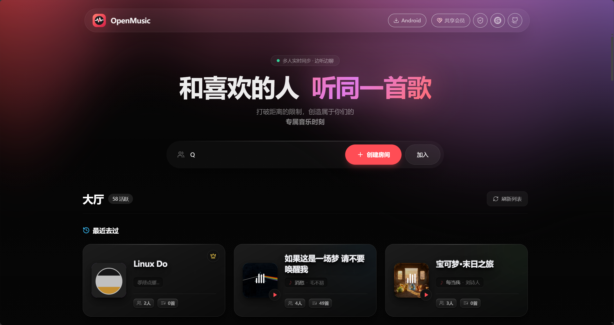
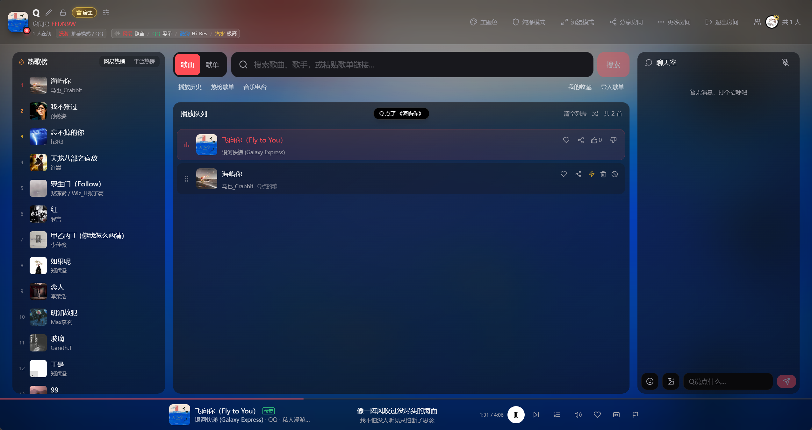
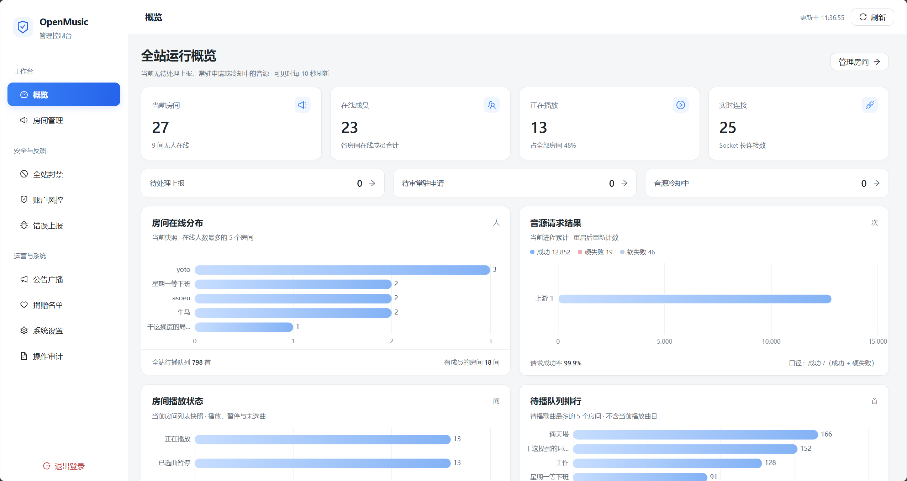

<h1 align="center">🎵 OpenMusic</h1>

<p align="center">
  <strong>多人实时在线点歌</strong><br/>
  多音源搜索 · 同步听歌 · 聊天互动 · AI 助手 · 3D 视觉 / 沉浸模式
</p>

<p align="center">
  
  
  
</p>

<p align="center">
  <a href="#-快速开始">🚀 快速开始</a> ·
  <a href="#-核心功能">✨ 核心功能</a> ·
  <a href="#-站点管理后台">🛡️ 管理后台</a> ·
  <a href="#-客户端构建">📱 客户端</a> ·
  <a href="#-文档与命令">📖 文档</a> ·
  <a href="#-交流群">👥 交流群</a> ·
  <a href="#-请作者喝一杯咖啡">☕ 请喝咖啡</a> ·
  <a href="docs/DEPLOY.md">📖 部署文档</a> ·
  <a href="deploy/DEPLOY-BAOTA.md">🛠️ 宝塔部署</a>
</p>

---

## 📸 项目截图

<p align="center">
  <a href="docs/screenshots/home.png">
    
  </a>
  <br/>
  <sub><b>首页大厅</b></sub>
</p>

<p align="center">
  <a href="docs/screenshots/room.png">
    
  </a>
  <br/>
  <sub><b>房间点歌</b></sub>
</p>

<p align="center">
  <a href="docs/screenshots/admin.png">
    
  </a>
  <br/>
  <sub><b>管理后台</b></sub>
</p>

---

## 🚀 快速开始

### 前置依赖

| 依赖 | 必填 | 说明 |
|------|:----:|------|
| Node.js | 源码部署 | `>=20 <25`（见 `.nvmrc`） |
| Redis | 是 | 房间、收藏、凭据、公告、封禁持久化 |
| [Meting-API](https://github.com/qq01-hub/Meting-API) | 是 | 搜索 / 播放 / 歌词 / 封面 / 歌单，提供 Docker 镜像 |
| 七牛 OSS | 否 | 聊天发图，可在管理后台配置 |

> Docker 全量版已内置 Redis 与 Meting，打开站点完成初始化向导即可使用

### Docker 一键部署（推荐）

```bash
curl -fsSL https://raw.githubusercontent.com/qq01-hub/openmusic/main/install.sh | bash
```

- **默认目录**：`/opt/openmusic`（数据位于 `/opt/openmusic/data`，可通过 `OPENMUSIC_DEPLOY_DIR=/srv/openmusic` 自定义；已有部署在原目录执行会沿用原路径与数据）
- **可选响度均衡**：统一多平台音量基准可追加 `OPENMUSIC_ENABLE_LOUDNESS=y`
- **访问地址**：
  - OpenMusic：`http://<服务器IP>:4000`（首次进入部署向导）
  - Meting 后台：`http://127.0.0.1:3000/<管理路径>`（仅限本机，凭据保存在部署目录 `.env`，远程可通过 `ssh -L 3000:127.0.0.1:3000 user@server` 转发访问，切勿直接暴露公网）
- **启用 HTTPS**：首次部署默认 `ALLOW_INSECURE_COOKIES=1` 支持 HTTP 登录；后续配置 HTTPS 后，请将 `.env` 中 `ALLOW_INSECURE_COOKIES` 改为 `0` 并重新 `up -d` 重建容器

```bash
cd /opt/openmusic
docker compose --env-file .env -f docker-compose.full.yml logs -f    # 查看日志
docker compose --env-file .env -f docker-compose.full.yml restart    # 重启服务
docker compose --env-file .env -f docker-compose.full.yml down       # 停止服务（切勿加 -v）
docker compose --env-file .env -f docker-compose.full.yml pull && docker compose --env-file .env -f docker-compose.full.yml up -d # 更新
```

> 更多网络子网配置、旧部署迁移与备份说明见 [部署文档](docs/DEPLOY.md) 与 [宝塔部署指南](deploy/DEPLOY-BAOTA.md)

已接入升级服务的部署可在 **管理后台 → 系统设置 → 系统升级** 检查并确认升级
Docker 拉取官方版本镜像，源码 / 发布包部署下载正式 ZIP，旧部署接入、停机影响与回滚说明见 [管理端系统升级](docs/SYSTEM_UPGRADE.md)

### 源码部署

```bash
git clone https://github.com/qq01-hub/openmusic.git && cd openmusic
npm run install:all && npm run build && npm start
```

打开 `http://<IP>:4000` 进入部署向导，生产环境建议配置 Nginx 反代（见 [部署文档](docs/DEPLOY.md)）

---

## ✨ 核心功能

### 🎧 听歌与音源

- **多音源聚合**：支持网易云音乐、QQ 音乐、汽水音乐、酷狗音乐搜索与播放
- **账号与漫游**：支持房间独立账号或共享会员池，提供网易 / QQ / 汽水 / 酷狗个性化漫游
- **本机音质偏好**：支持无损 / 臻音 / 母带等档位（受平台与 SVIP 开关约束），弱设备自动降档，下一首起生效
- **同步与播放模式**：多人实时同步；支持顺序、随机、按用户轮流、收藏随机、单曲循环、列表循环等模式；可授权成员暂停与拖进度
- **发现与歌单导入**：内置热歌榜、推荐歌单、音乐电台；支持四大平台歌单链接 / ID 导入、多歌单漫游与按歌名去重（单歌单上限 5000 首）；个人收藏与历史支持 JSON 导入导出
- **队列控制**：拖拽排序、插队、清空，以及防误触系统媒体键开关

### 🏠 房间与权限

- **房间大厅**：公开大厅、随机匹配、密码房、常驻房申请、最近访问、链接与二维码分享
- **个性化装扮**：自定义房间封面、进房公告弹窗、主题色、自定义贵宾等级（角标 / 颜色 / 边框 / 欢迎语 / 礼花）与成员归属地展示
- **权限与托管**：房主转让、正式管理员、房主离线临时控播；新建房间自动沿用本机上次的点歌与聊天规则
- **纯净模式**：一键隐藏动效与热榜、遮罩聊天图片与贴纸、伪装浏览器标签页标题与图标
- **账户体系**：首页可直接浏览，登录后加入房间点歌与跨设备同步收藏；支持邮箱注册及 **Linux.do、GitHub、微信扫码** 登录

| 点歌规则 | 说明 |
|------|------|
| 成员权限 | 可分别开关成员点歌、插队、拖动进度 / 暂停 |
| 频率与配额 | 支持进房等待时长、每人点歌上限、点歌冷却（10s~120s）、队列上限（50/100/200） |
| 秩序维护 | 支持跨平台歌名禁播、按人数或比例踩歌切歌、成员离房超时自动清除待播 |

### 💬 聊天与互动

- **实时聊天**：支持贴纸、发图、微信表情包采集与搜索、回复 / `@` / `@全体`、限时撤回
- **聊天音乐卡片**：队列或搜索结果一键分享到聊天；点击卡片封面可在本机独立试听（带滚动歌词与进度拖动，不影响房间当前播放，暂停或播完自动切回房间音频），并支持就地收藏或加歌
- **房间风控**：全员禁言、单人禁言、踢人、任命管理、自定义违禁词过滤

### 🤖 房间 AI 助手

- **对话与控播**：在聊天中 `@` 机器人或用触发词提问，支持按用户隔离上下文、自然语言搜歌、查看状态、管理队列与点歌
- **卡片候选确认**：核对同名或翻唱曲目时，AI 会合并发送音乐卡片供本机试听确认，避免点错歌
- **识图点歌**：发送歌单截图或专辑封面，AI 可识别图片内容并联动音乐工具处理
- **多模型池**：后台支持配置 OpenAI 兼容接口（文本模型 + 视觉模型）、模型池切换、限流与故障降级；默认关闭，不配置不影响基础功能

### 🌌 视觉与多端

- **沉浸视觉**：星河 / 声波地形 3D 背景、封面高斯模糊、桌面舞台歌词沉浸模式
- **多端覆盖**：Web 响应式界面、Electron 桌面端、Android 客户端（支持锁屏 / 通知栏播放控制与桌面可拖动悬浮歌词）

---

## 🛡️ 站点管理后台

部署向导会生成**随机管理员账号**和**随机管理入口**（非固定 `/admin`），仅在初始化完成页展示一次，请妥善保存

| 场景 | 处理方式 |
|------|------|
| 忘记密码 | 执行 `redis-cli DEL openmusic:admin:credentials` 后重启服务，恢复默认 `admin` / `123456` |
| 忘记入口 | 查看 `server/adminConfig.json`（Docker 为 `data/adminConfig.json`）中的 `entryPath` |
| 快捷进入 | 本机浏览器访问过真实入口后会在 `localStorage` 记录路径，首页顶栏将显示仅本机可见的盾牌图标 |

**后台核心能力：**
- **运行时配置**：音源、Meting、SVIP 音质、共享会员、第三方登录（Linux.do / GitHub / 微信）、七牛 OSS、SEO 等在线保存即生效
- **AI 管理**：全局开关、机器人名称、文本 / 视觉模型池、限流参数与连通性测试（API Key 服务端加密存储）
- **房间与账户治理**：房间搜索、密码查看、解散、常驻审核、违规昵称重置、全站 IP / 设备封禁、账户风控、全局广播与操作审计

> **OAuth 回调提示**：在管理后台「运行时配置 → 身份登录」启用 Linux.do（回调 `https://你的域名/api/auth/linuxdo/callback`）或 GitHub（回调 `https://你的域名/api/auth/github/callback`）时，请确保应用后台与本站配置的 `redirect_uri` 协议、域名、路径完全一致

---

## 📱 客户端构建

### Android 应用（Flutter WebView）

```powershell
cd mobile
flutter pub get
node scripts/build-flutter-apk.mjs --release --server-url=https://your-host
```

产物输出至 `mobile/build/app/outputs/flutter-apk/app-release.apk` 并自动复制到 `server/downloads/openmusic.apk`，详情见 [`mobile/README.md`](mobile/README.md) 与 [`docs/MOBILE.md`](docs/MOBILE.md)

### Windows 桌面端（Electron）

```powershell
npm run desktop:build
# 无交互构建：$env:OPENMUSIC_DESKTOP_URL='https://music.example.com'; npm run desktop:build
```

---

## 🧱 技术栈

| 层级 | 技术 |
|------|------|
| 前端 | React · Vite · TypeScript · Tailwind CSS · Socket.IO Client · Three.js / R3F |
| 移动端 | Flutter · WebView · just_audio · audio_service |
| 后端 | Node.js · Express · Socket.IO · Redis（必需） |

---

## 📖 文档与命令

| 文档 | 说明 |
|------|------|
| [AI 协作指南](AGENTS.md) | 项目边界、不可破坏契约、验证流程与禁止事项 |
| [部署文档](docs/DEPLOY.md) | 环境变量、Nginx、Docker 细节、迁移备份与 API 速查 |
| [宝塔部署](deploy/DEPLOY-BAOTA.md) | 宝塔面板 Docker / 源码部署步骤 |
| [移动端文档](docs/MOBILE.md) | Flutter 工程结构与本地调试 |
| [Nginx 配置示例](deploy/nginx.conf.example) | 通用反代配置（宝塔优化版见 `deploy/nginx.baota-optimized.conf.example`） |

```bash
npm run install:all   # 安装全部依赖
npm run dev           # 启动前后端开发环境（前端 :5173，后端 :4000）
npm run build         # 构建前端产物至 client/dist
npm start             # 启动生产环境后端
npm run package:build # 组装发版包
```

健康检查：`GET /api/health`

---

## 👥 交流群

欢迎加入 OpenMusic QQ 交流群，交流使用体验、部署问题与功能建议：

<p align="center">
  
</p>

---

## ☕ 请作者喝一杯咖啡

如果 OpenMusic 对你有帮助，欢迎请作者喝杯咖啡，支持持续维护

<table>
  <tr>
    <td align="center" width="50%" valign="top">
      <a href="docs/donate/wechat.png">
        
      </a>
      <br/><sub><b>微信</b></sub>
    </td>
    <td align="center" width="50%" valign="top">
      <a href="docs/donate/alipay.png">
        
      </a>
      <br/><sub><b>支付宝</b></sub>
    </td>
  </tr>
</table>

---

## 🙏 致谢

| 项目 | 作者 | 说明 |
|------|------|------|
| [Mineradio](https://github.com/XxHuberrr/Mineradio) | [@XxHuberrr](https://github.com/XxHuberrr) | 星河粒子、沉浸玻璃质感、舞台歌词等 |
| [folia-major](https://github.com/chthollyphile/folia-major) | [@chthollyphile](https://github.com/chthollyphile) | 沉浸模式视觉与交互灵感 |

## 🔗 友情链接

- [Linux.do](https://linux.do/) — 新的理想型社区

## ⚠️ 免责声明

本项目仅供学习与技术交流，不存储音频文件，音乐版权归相关权利人所有，请遵守法律法规及平台协议，不得用于商业用途

## 📄 License

[MIT（附注明出处条款）](LICENSE)：可自由使用、修改、分发；公开分发或部署时须注明出处（项目名「OpenMusic」及原始仓库链接）
