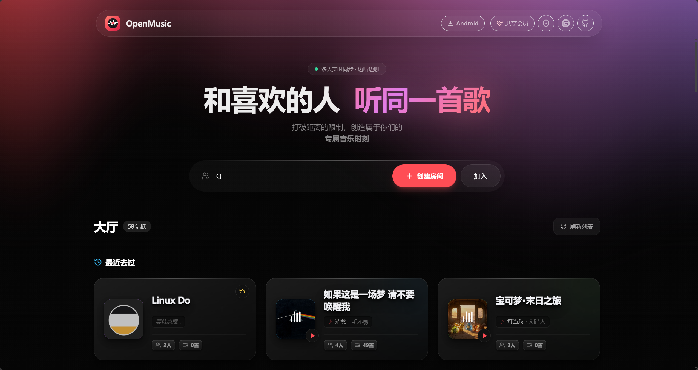
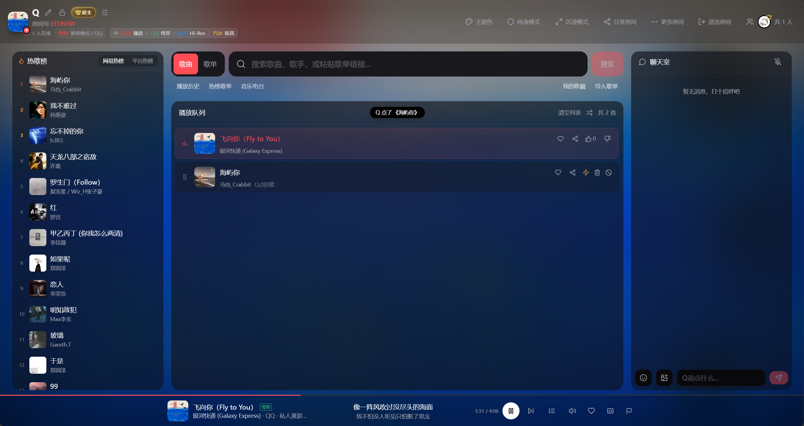
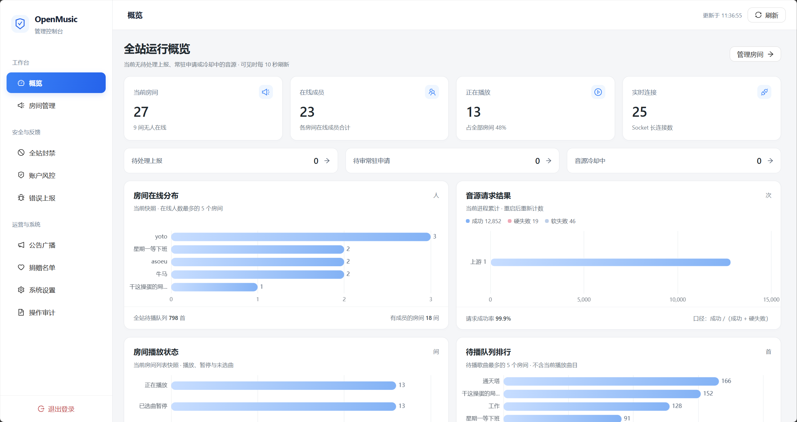
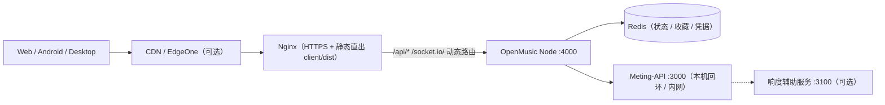

<div align="center">

# 🎵 OpenMusic

**创建一个音乐房间，和朋友一起点歌、听歌、聊天**

网易云 / QQ / 汽水 / 酷狗 · 实时同步播放 · AI 助手 · Web / Android / Windows

<p>
  
  
  
  =20 <25" />
  
  
</p>

<p>
  <a href="#preview"><b>界面预览</b></a> &nbsp;·&nbsp;
  <a href="#quick-start"><b>一键部署</b></a> &nbsp;·&nbsp;
  <a href="#architecture"><b>生产架构</b></a> &nbsp;·&nbsp;
  <a href="#features"><b>核心功能</b></a> &nbsp;·&nbsp;
  <a href="#admin"><b>管理后台</b></a> &nbsp;·&nbsp;
  <a href="#clients"><b>多端客户端</b></a> &nbsp;·&nbsp;
  <a href="#docs"><b>完整文档</b></a> &nbsp;·&nbsp;
  <a href="#community"><b>交流与赞助</b></a>
</p>

</div>

<table>
  <tr>
    <td align="center" width="25%"><b>🎧 四源聚合同步</b><br/><sub>网易 / QQ / 汽水 / 酷狗<br/>毫秒级多人同步播放</sub></td>
    <td align="center" width="25%"><b>🤖 AI 识图控播</b><br/><sub>自然语言点歌查队<br/>内置 7 入口免费联网</sub></td>
    <td align="center" width="25%"><b>🚀 一行命令部署</b><br/><sub>自动避端口与配 Token<br/>后台热更新免改配置</sub></td>
    <td align="center" width="25%"><b>📱 全端沉浸体验</b><br/><sub>3D 星河与舞台歌词<br/>Web / Android / Windows</sub></td>
  </tr>
</table>

---

<a id="preview"></a>

## 📸 界面预览

<p align="center">
  
  <br/>
  <sub><b>首页大厅</b> — 公开房 · 随机匹配 · 最近访问 · 热歌发现</sub>
</p>

<table>
  <tr>
    <td align="center" width="50%">
      
      <br/><sub><b>房间点歌主界面</b> — 同步播放 · 实时歌词 · 队列互动 · 聊天与 AI 助手</sub>
    </td>
    <td align="center" width="50%">
      
      <br/><sub><b>站点管理后台</b> — 运行时热更新 · 风控审计 · 在线系统升级</sub>
    </td>
  </tr>
</table>

---

<a id="quick-start"></a>

## 🚀 一键部署

在 Linux 服务器执行下面一行命令，全程全自动，最多按 `Y/N` 确认即可完成部署：

```bash
curl -fsSL https://raw.githubusercontent.com/qq01-hub/openmusic/main/install.sh -o install.sh && bash install.sh
```

<table>
  <tr>
    <td width="25%" valign="top"><b>1. 自动装环境</b><br/><sub>缺失 Docker 或未启动时直接回车即可自动安装并拉起</sub></td>
    <td width="25%" valign="top"><b>2. 自动避冲突</b><br/><sub>4000 / 3000 端口与默认子网被占用时自动顺延切换</sub></td>
    <td width="25%" valign="top"><b>3. 自动配音源</b><br/><sub>生成 600 权限随机密钥，启动全家桶并自动配对 Meting Token</sub></td>
    <td width="25%" valign="top"><b>4. 自动备反代</b><br/><sub>容器健康体检通过后自动生成填好端口的 Nginx HTTPS 模板</sub></td>
  </tr>
</table>

**部署后极简三步：**

1. 按终端提示完成 `Y/N` 选择（是否启用响度均衡、是否临时开放公网端口直接用 IP 体验）
2. 打开脚本输出的 `/setup` 向导地址（默认本机回环复制一行 SSH 隧道命令访问；选公网体验则直接打开 `http://服务器IP:端口/setup`）
3. 确认向导预填配置并保存随机管理员凭据，服务自动重启即可开始点歌

> 默认部署目录为 `/opt/openmusic`；正式上线域名可直接复用自动生成的 `nginx-openmusic-docker.conf`，详见 [生产上线步骤](docs/DEPLOY.md#nginx-与-cdn-边缘缓存建议)

| 你的服务器环境 | 推荐入口 | 说明 |
|---|---|---|
| **全新 Linux 服务器** | 上方 `install.sh` 一键命令 | 自动拉起 OpenMusic + Redis + Meting（可选响度） |
| **宝塔面板** | [宝塔部署指南](deploy/DEPLOY-BAOTA.md) | 支持一键 Docker 接入与可视化 SSL / Nginx 配置 |
| **自定义 Compose / 外部音源** | [Docker 手动部署](docs/DEPLOY.md#方式二docker-手动-compose) | 自主管理 Compose 文件、内网子网与外部 Meting |
| **已有 Node.js 与 Redis** | [源码 + PM2 部署](docs/DEPLOY.md#方式三源码部署pm2) | `bash deploy/deploy.sh source` 自动构建、托管并健康体检 |

<details>
<summary><b>运维命令、在线升级与源码部署</b></summary>
<br/>

#### Docker 日常运维

```bash
cd /opt/openmusic
docker compose -f docker-compose.full.yml ps
docker compose -f docker-compose.full.yml logs -f openmusic
```

响度版保留 `-f docker-compose.loudness.yml`，已有部署沿用原项目名，升级前备份配置和数据

#### 管理后台一键在线升级

已接入升级服务的部署可直接在 **管理后台 → 系统设置 → 系统升级** 检查并确认更新（Docker 拉取官方镜像，源码 / 发布包部署下载正式 ZIP），详情与旧部署接入方式见 [管理端系统升级](docs/SYSTEM_UPGRADE.md)

#### 源码部署（PM2）

```bash
git clone https://github.com/qq01-hub/openmusic.git && cd openmusic
bash deploy/deploy.sh source
```

#### 前置依赖对照

| 依赖 | 必填 | 说明 |
|------|:----:|------|
| Node.js | 源码部署 | `>=20 <25`（见 `package.json` 的 `engines.node`） |
| Redis | 必需 | 房间、收藏、凭据、公告、封禁持久化 |
| [Meting-API](https://github.com/qq01-hub/Meting-API) | 必需 | 搜索 / 播放 / 歌词 / 封面 / 歌单解析，Docker 全量版已内置 |
| 七牛 OSS | 可选 | 聊天发图存储，可在管理后台直接配置 |

</details>

---

<a id="architecture"></a>

## 🏗️ 推荐生产架构



源码部署可用 Nginx 直出 `client/dist`，Docker 镜像部署由容器提供页面与接口：[源码 Nginx 示例](deploy/nginx.conf.example) · [Docker HTTPS 反代](docs/DEPLOY.md#docker-镜像上线-https) · [CDN 缓存建议](docs/DEPLOY.md#cdn-与-edgeone-边缘缓存速查)

---

<a id="features"></a>

## ✨ 核心功能

### 🎧 听歌与音源

| 能力 | 说明 |
|------|------|
| **四源聚合播放** | 支持 **网易云 / QQ / 汽水 / 酷狗** 搜索、播放、滚动歌词与双语翻译 |
| **账号与个性漫游** | 优先使用房间独立账号，否则回退全站共享会员池，支持四大平台个性漫游 |
| **本机音质偏好** | 支持无损 / 臻音 / 母带等档位（受平台与 SVIP 开关约束），弱设备自动降档，切歌生效 |
| **多人同步与模式** | 毫秒级进度同步；提供顺序、随机、按人轮流、收藏随机、单曲 / 列表循环，可授权成员控播 |
| **发现与歌单导入** | 内置热歌榜、推荐歌单与电台；支持链接 / ID 批量导入（上限 5000 首）、多歌单漫游与收藏 JSON 导入导出 |
| **队列与防误触** | 支持拖拽排序、插队、清空与系统媒体键防误触开关 |

### 🏠 房间、权限与秩序

| 能力 | 说明 |
|------|------|
| **大厅与分享** | 公开大厅、随机匹配、密码房、常驻房申请、最近访问、链接与二维码分享 |
| **房间个性化装扮** | 自定义封面、进房公告、主题色、贵宾等级（角标 / 边框 / 欢迎语 / 礼花）与成员归属地 |
| **权限与托管** | 房主转让、正式管理员、房主离线临时控播；新建房间自动沿用本机上次点歌与聊天规则 |
| **细粒度点歌秩序** | 成员点歌 / 插队 / 控播开关、点歌冷却（10s~120s）、每人上限、队列上限、跨平台禁播词、踩歌切歌与离房自动清队 |
| **办公纯净模式** | 一键隐藏动效与热榜、遮罩图片与贴纸，并伪装浏览器标签页标题与图标 |
| **多渠道账户体系** | 支持邮箱注册及 **Linux.do / GitHub / 微信 / QQ 扫码** 登录，跨设备同步收藏，后台可一键切换匿名访问 |

### 💬 聊天互动、🤖 AI 助手与 🌌 沉浸多端

| 模块 | 说明 |
|------|------|
| **实时聊天互动** | 贴纸、发图、微信表情包采集与搜索、回复 / `@` / `@全体`、限时撤回、禁言踢人与自定义违禁词 |
| **音乐卡片独立试听** | 搜索或队列一键分享到聊天；点封面可**本机独立试听**（带歌词与进度拖动，不影响房间播放，结束自动切回） |
| **AI 对话与自然控播** | 聊天中 `@` 机器人按用户隔离上下文，支持自然语言搜歌、查队列、控播与卡片候选试听确认 |
| **AI 识图与免费联网** | 发送歌单截图或封面即可识图点歌；内置 [7 入口免费联网搜索](docs/ai-web-search.md)（免搜索 Key），后台支持多模型池与故障降级 |
| **沉浸视觉与多端** | 星河 / 声波地形 3D 背景与桌面舞台歌词；覆盖 Web、Electron Windows 桌面端与 Flutter Android 客户端（锁屏控播 + 悬浮歌词） |

---

<a id="admin"></a>

## 🛡️ 站点管理后台

部署向导会自动生成**随机管理员账号**与**随机管理入口**（非固定 `/admin`），仅在初始化完成页展示一次，请妥善保存

| 常见问题 | 快速处理 |
|------|------|
| **忘记随机入口** | 查看 `server/adminConfig.json`（Docker 为 `data/adminConfig.json`）中的 `entryPath` |
| **本机快捷入口** | 浏览器访问过真实入口后会在 `localStorage` 记录路径，首页顶栏显示仅本机可见的盾牌图标 |

<table>
  <tr>
    <td width="33%" valign="top">
      <b>⚙️ 运行时配置（热更新）</b><br/>
      音源与 Meting、SVIP 音质、共享会员池、OAuth / 扫码登录、注册邮箱 SMTP、七牛 OSS、SEO 等在线保存即生效
    </td>
    <td width="33%" valign="top">
      <b>🤖 AI 模型管理</b><br/>
      全局开关、机器人名称、OpenAI 兼容文本 / 视觉模型池、限流阈值与连通性测试（API Key 服务端加密保存）
    </td>
    <td width="33%" valign="top">
      <b>🔒 房间与安全治理</b><br/>
      房间搜索 / 解散 / 常驻审核、违规昵称重置、全站 IP / 设备封禁、账户风控、全局广播、操作审计与在线升级
    </td>
  </tr>
</table>

> **OAuth 回调提示**：在管理后台「运行时配置 → 身份登录」启用 Linux.do（`https://你的域名/api/auth/linuxdo/callback`）或 GitHub（`https://你的域名/api/auth/github/callback`）时，请确保第三方应用与本站填写的 `redirect_uri` 协议、域名与路径完全一致

---

<a id="clients"></a>

## 📱 多端客户端构建

<details>
<summary><b>📦 展开查看 Android（Flutter）与 Windows（Electron）构建命令</b></summary>
<br/>

### Android 应用（Flutter WebView）

```powershell
cd mobile
flutter pub get
node scripts/build-flutter-apk.mjs --release --server-url=https://your-host
```

产物输出至 `mobile/build/app/outputs/flutter-apk/app-release.apk` 并自动复制到 `server/downloads/openmusic.apk`，详情见 [`mobile/README.md`](mobile/README.md) 与 [`docs/MOBILE.md`](docs/MOBILE.md)

### Windows 桌面端（Electron）

```powershell
npm run desktop:build
# 无交互构建：$env:OPENMUSIC_DESKTOP_URL='https://music.example.com'; npm run desktop:build
```

</details>

---

## 🧱 技术栈

| 层级 | 核心技术 |
|------|------|
| **前端** | React · Vite · TypeScript · Tailwind CSS · Socket.IO Client · Three.js / R3F |
| **后端** | Node.js（`>=20 <25`）· Express · Socket.IO · Redis（必需） |
| **移动端 / 桌面端** | Flutter · WebView · just_audio · audio_service · Electron |

---

<a id="docs"></a>

## 📖 文档地图与常用命令

| 文档 | 适用内容 |
|------|------|
| [完整部署文档](docs/DEPLOY.md) | 环境变量、Docker 网络与迁移、Nginx & CDN 缓存规范、备份回滚与 API 速查 |
| [宝塔部署指南](deploy/DEPLOY-BAOTA.md) | 宝塔面板 Docker Compose / 源码 PM2 部署与故障排查 |
| [系统在线升级](docs/SYSTEM_UPGRADE.md) | 管理后台在线更新接入、Docker / ZIP 升级流程与回滚说明 |
| [Nginx 配置示例](deploy/nginx.conf.example) | 通用生产反代配置（完整宝塔版见 [nginx.baota-optimized.conf.example](deploy/nginx.baota-optimized.conf.example)） |
| [AI 免费联网搜索](docs/ai-web-search.md) | 7 入口公开联网搜索能力说明与配置 |
| [沉浸舞台文档](docs/FOLIA_IMMERSIVE.md) | 桌面舞台歌词与沉浸视觉架构说明 |
| [歌词翻译说明](docs/lyrics-translation.md) | 歌词加载、匹配与翻译规则 |
| [移动端文档](docs/MOBILE.md) | Flutter 工程结构、桥接契约与本地调试 |
| [AI 协作指南](AGENTS.md) | 项目边界、不可破坏契约、验证流程与禁止事项 |

```bash
npm run install:all   # 安装根目录、后端与前端全部依赖
npm run dev           # 启动本地开发环境（前端 :5173，后端 :4000）
npm run build         # 构建前端生产产物至 client/dist
npm start             # 启动生产环境后端
npm run package:build # 交互式组装发布包
```

健康检查接口：`GET /api/health`

---

<a id="community"></a>

## 👥 交流群 & ☕ 支持项目

欢迎加入 OpenMusic QQ 交流群反馈建议和交流部署经验，也可以请作者喝杯咖啡支持持续维护

<div align="center">
<table>
  <tr>
    <th align="center" width="220">QQ 交流群</th>
    <th align="center" width="220">微信赞赏</th>
    <th align="center" width="220">支付宝赞赏</th>
  </tr>
  <tr>
    <td align="center" valign="middle">
      
    </td>
    <td align="center" valign="middle">
      
    </td>
    <td align="center" valign="middle">
      
    </td>
  </tr>
</table>
</div>

---

## 🙏 致谢与友情链接

| 项目 | 作者 | 说明 |
|------|------|------|
| [Mineradio](https://github.com/XxHuberrr/Mineradio) | [@XxHuberrr](https://github.com/XxHuberrr) | 星河粒子、沉浸玻璃质感、舞台歌词等 |
| [folia-major](https://github.com/chthollyphile/folia-major) | [@chthollyphile](https://github.com/chthollyphile) | 沉浸模式视觉与交互灵感 |
| [dafeiyu-pet](https://github.com/shenliuyu18/dafeiyu-pet) | [@shenliuyu18](https://github.com/shenliuyu18) | 桌宠角色素材、动作配置与互动实现参考 |
| [dsh-pet](https://github.com/PC2005-cloud/dsh-pet) | [@PC2005-cloud](https://github.com/PC2005-cloud) | 桌宠原始动画与拖拽、弹射、碰撞等物理算法参考 |

- **友情链接**：[Linux.do](https://linux.do/) — 新的理想型社区

## ⚠️ 免责声明 & 📄 License

- **免责声明**：本项目仅供学习与技术交流，不存储音频文件，音乐版权归相关权利人所有，请遵守法律法规及平台协议，不得用于商业用途
- **开源协议**：[MIT（附注明出处条款）](LICENSE) — 可自由使用、修改、分发；公开分发或部署时须注明出处（项目名「OpenMusic」及原始仓库链接）
